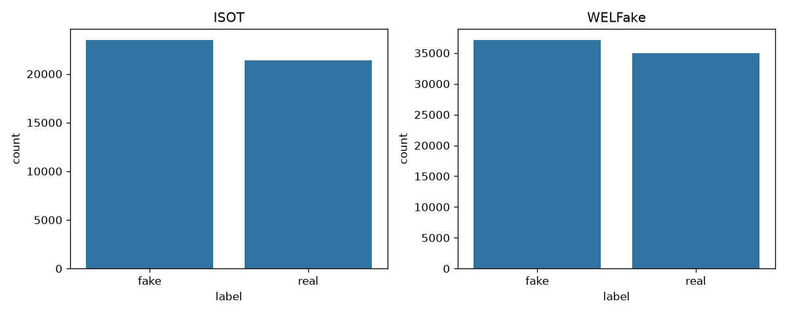
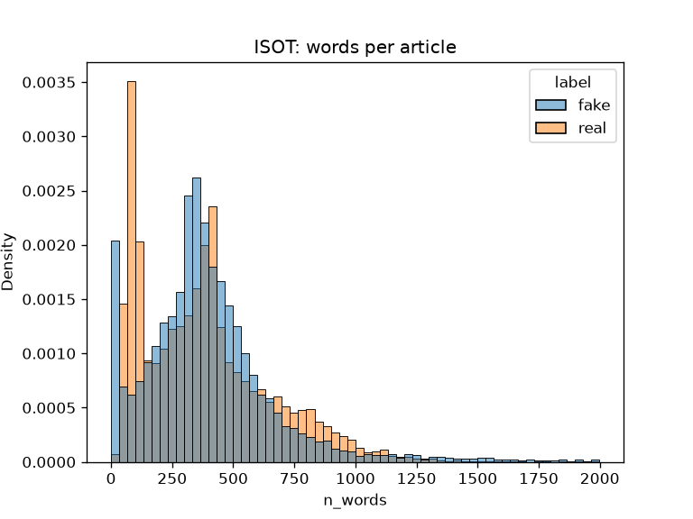

# Fake News Detector

Detects likely fake news articles using classical NLP (TF-IDF, Logistic Regression, SVM)
and transformers (DistilBERT), with a leakage audit and cross-dataset evaluation.

## Status

Work in progress.

- Phase 0 (setup) done.
- Phase 1 (data) done: ISOT and WELFake loaders in a shared format, with tests.
  The WELFake label mapping was verified by reading samples; it is the opposite of
  its published description. See [data/README.md](data/README.md).
- Phase 2 (first-look EDA) done: [notebooks/01_eda.ipynb](notebooks/01_eda.ipynb).

## Key findings so far (EDA on ISOT)

The ISOT dataset is full of shortcuts that have nothing to do with whether a story is true:

| Finding | Fake | Real | Why it matters |
|---|---|---|---|
| Text contains "(Reuters)" | 0.0% | 99.2% | A one-line rule gets about 99.6% accuracy without reading the article |
| `subject` values shared between classes | none | none | A perfect leak, so it is never used as a feature |
| Empty texts | 630 | 1 | Teaches "empty = fake" |
| Rows involved in exact duplicates | 10,671 | 427 | Duplicates in both train and test inflate scores |
| Title starts with a space | 38.5% | 0.0% | Scraper formatting artifact |
| Title has an ALL-CAPS word | 79.6% | 2.5% | Likely a real clickbait style (also seen in WELFake) |
| Date range | 2015-03 to 2018-02 | 2016-01 to 2017-12 | Time leak, so a time-based split is planned |

Plan: drop empty and broken rows, deduplicate before splitting, remove the Reuters byline and
formatting artifacts, then audit what the model actually learns (leakage audit + cross-dataset test).

## Data

Datasets are not committed. See [data/README.md](data/README.md) for download links,
sizes, label definitions and known issues (source and formatting leaks).

## Setup

    python3.12 -m venv .venv
    source .venv/bin/activate
    pip install -r requirements.txt
    pip install -e .
    python -m spacy download en_core_web_sm
    python scripts/setup_nltk.py

## Project structure

    data/raw/         original datasets (not committed)
    data/processed/   cleaned data (generated)
    notebooks/        exploration and analysis
    src/fakenews/     reusable package code
    tests/            pytest tests
    models/           trained models (not committed)
    reports/figures/  charts used in this README
    app/              API and demo
